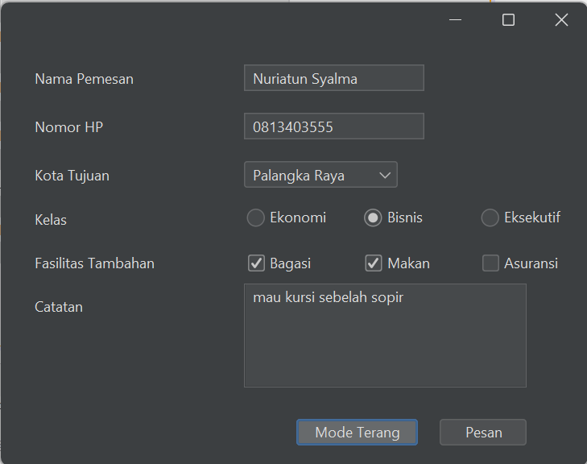
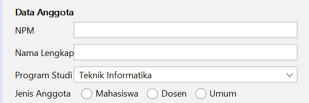
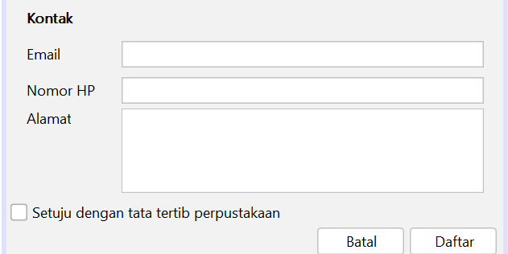
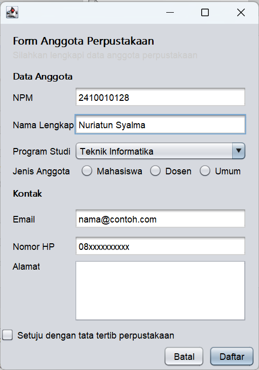
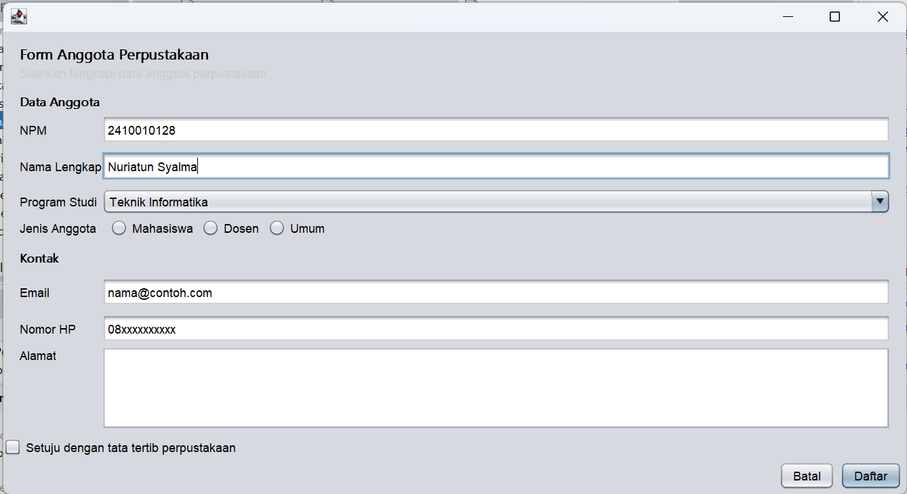

# pbo2-2410010128
# Praktikum 1 - PBO 2

Repository ini berisi tugas Praktikum 1 Pemrograman Berbasis Objek 2.

## Hasil Eksekusi Program

### 1. Program HaloPBO2

### 2. Program KartuMahasiswa

## Riwayat Commit Git

# Praktikum 2 - PBO 2
## Hasil Run Program Skripsi

## Jawaban Singkat Eksperimen
Eksperimen: lakukan satu per satu, amati hasilnya, lalu kembalikan kode seperti semula.

## 1.Tambahkan baris Koleksi x = new Koleksi("X01", "Uji", 2026); di method main. Apa pesan error dari kompiler dan mengapa?
(Terdapat juga peringatan/warning tambahan: Variable x is never read karena variabel x tersebut belum digunakan di mana pun). Kenapa itu bisa terjadi karena di baris kode 71, Anda mencoba membuat objek langsung dari kelas Koleksi menggunakan kata kunci new:

## 2.Pada kelas Buku, ubah nama method hitungDenda menjadi hitungdenda. Apa yang terjadi jika anotasi @Override ada, dan jika dihapus?
Jika ada @Override: Akan error. Java bingung karena di kelas induk namanya pakai 'D' besar (hitungDenda), jadi tidak ada method yang cocok untuk ditimpa.
Jika @Override dihapus: Tetap error. Kelas Buku itu wajib mewarisi dan membuat ulang method hitungDenda (D besar). Kalau pakai 'd' kecil, Java menganggap Anda membuat method baru dan mengabaikan tugas wajibnya.

## 3.Tambahkan new Buku("B009", "", 2020, "Anonim"). Apa yang terjadi saat program dijalankan?
Yang terjadi: Program kemungkinan besar akan error atau berhenti mendadak (crash) saat dijalankan.
Alasannya: Ada aturan di dalam kode yang melarang judul buku dikosongkan. Karena datanya tidak valid, program menolak membuat buku tersebut.

## 4.Ubah private StatusKoleksi status menjadi public, lalu ubah status B002 langsung dari main menjadi TERSEDIA saat masih dipinjam. Aturan apa yang dilanggar?
Aturan yang dilanggar: Enkapsulasi (aturan pelindungan data agar tidak bisa diubah sembarangan dari luar).
Alasannya: Bikin data kacau. Kalau diubah paksa, sistem akan mengira buku itu "Tersedia" dan bisa dipinjam orang lain lagi, padahal fisiknya masih dibawa oleh si peminjam pertama. Perubahan status harus lewat jalur resmi (method pinjam atau kembalikan).

# Praktikum 3 - PBO 2
## Form Tiket Travel Tema Terang

## Form Tiket Travel Tema Gelap

## Tab Design Tiket Travel

## Jawaban Refleksi
## 1.Apa perbedaan top-level container, intermediate container, dan atomic component? Berikan masing-masing satu contoh.
## 2.Mengapa kedua JRadioButton perlu diberi properti buttonGroup yang sama?
## 3.Kapan Anda memilih JComboBox dibandingkan JRadioButton?
## 4.Mengapa kode di dalam initComponents() tidak boleh diedit langsung, dan di mana kode tambahan seharusnya ditulis?
## 5.Mengapa FlatLightLaf.setup() harus dipanggil sebelum form dibuat? 
Jawab :
## 1.Top-level container adalah jendela utama yang menjadi tempat menampilkan aplikasi. Contohnya JFrame.
## Intermediate container adalah wadah yang digunakan untuk mengelompokkan komponen lain. Contohnya JPanel.
## Atomic component adalah komponen yang langsung digunakan untuk berinteraksi dengan pengguna. Contohnya JButton.
## 2.Karena JRadioButton digunakan untuk memilih satu pilihan saja dari beberapa pilihan. Dengan memberikan buttonGroup yang sama, ketika satu pilihan dipilih, pilihan lainnya otomatis tidak terpilih. 
## 3.Saya akan memilih JComboBox ketika pilihan yang tersedia cukup banyak, sehingga lebih menghemat tempat pada form. Sedangkan JRadioButton lebih cocok jika pilihannya sedikit dan ingin semua pilihan langsung terlihat.
## 4.Karena initComponents() dibuat secara otomatis oleh NetBeans dari pengaturan pada tab Design. Kode tersebut dapat dibuat ulang atau berubah ketika form diedit, sehingga tidak boleh diubah langsung. Kode tambahan seharusnya ditulis di luar blok initComponents(), misalnya di konstruktor setelah initComponents(), pada event handler, atau pada method bantu.
## 5.Karena FlatLightLaf.setup() digunakan untuk mengaktifkan tema tampilan FlatLaf. Perintah ini dipanggil terlebih dahulu sebelum membuat form, agar form yang dibuat langsung menggunakan tampilan FlatLaf. 

# Praktikum 4 - PBO 2
# Jawaban pertanyaan refleksi pada bagian G
### 1. Mengapa Null Layout dan Absolute Layout sebaiknya dihindari?

Karena posisi komponen diatur secara manual, sehingga tampilan bisa berantakan ketika ukuran jendela berubah atau dibuka di layar yang berbeda. Lebih baik menggunakan layout manager agar komponen tersusun lebih rapi dan mudah menyesuaikan ukuran jendela.

### 2. Jelaskan perbedaan perilaku FlowLayout dan GridLayout saat jendela dilebarkan.

FlowLayout menyusun komponen secara berurutan dari kiri ke kanan. Kalau jendela diperkecil, komponen bisa pindah ke baris berikutnya. Sedangkan GridLayout membagi komponen ke dalam baris dan kolom dengan ukuran sel yang sama. Saat jendela dilebarkan, ukuran sel ikut menyesuaikan.

### 3. Apa fungsi Weight X dan Fill pada constraint GridBagLayout?

Weight X mengatur pembagian ruang tambahan secara horizontal untuk komponen. Kalau nilainya lebih besar, komponen mendapat bagian ruang yang lebih banyak. Fill mengatur apakah komponen akan memenuhi ruang yang tersedia. Contohnya, Fill Horizontal membuat komponen melebar mengikuti ruang yang ada.

### 4. Mengapa formPanel dibungkus isiPanel dan diletakkan di North?

Agar susunan form lebih teratur dan mudah diatur. Dengan isiPanel sebagai pembungkus, formPanel bisa ditempatkan di bagian atas menggunakan BorderLayout.NORTH, sehingga bagian form tidak memenuhi seluruh area dan masih ada ruang untuk bagian lain.

### 5. Sebutkan dua prinsip desain yang Anda terapkan pada Form Anggota Perpustakaan dan tunjukkan buktinya.

**a. Pengelompokan komponen**

Komponen yang berhubungan diletakkan berdekatan. Contohnya, NPM, nama lengkap, dan program studi dikelompokkan pada bagian Data Anggota, sedangkan email, nomor HP, dan alamat berada pada bagian Kontak.
# Bukti a

**b. Konsistensi dan kerapian**

Komponen disusun menggunakan layout manager agar lebih teratur. Contohnya, pilihan Mahasiswa, Dosen, dan Umum disusun berdekatan, sedangkan tombol Batal dan Daftar ditempatkan di bagian bawah sebelah kanan.
# Bukti b

# Foto Sketsa

# Tabel Rancangan
### Tahap 2: Tabel Rancangan

| Bagian | Panel | Layout |
|---|---|---|
| Jendela | JFrame | BorderLayout |
| Header | headerPanel | BoxLayout (Y_AXIS) |
| Isi form | isiPanel | BorderLayout |
| Data anggota | formPanel | GridBagLayout |
| Pilihan jenis anggota | jenisAnggotaPanel | FlowLayout (LEFT) |
| Tombol | tombolPanel | FlowLayout (RIGHT) |

# Hasil Form Anggota Perpustakaan
## Form Ukuran Awal

## Form Ukuran Lebar

## Tab Design FormAnggotaPerpustakaan

## Jawaban Eksperimen Praktikum 2
### Eksperimen:
### 1.Pada flowPanel, ubah Alignment layout menjadi Center, lalu kecilkan jendela. Apa yang berubah? (Ketika diubah tombol yang ada di dalam flowPanel jadi rata tengah dan ketika jendelanya diperkecil tombol yang tidak muat akan berpindah ke baris berikutnya tetapi tetap di posisi rata tengah.)
### Baris mana di initComponents() yang ikut berubah? (Yang berubah dalam initComponents() itu pengaturan alignment pada flowPanel yang awalnya FlowLayout.LEFT menjadi FlowLayout.CENTER)
### 2.Pada gridPanel, ubah Rows menjadi 0 dan Columns menjadi 2. Berapa baris yang terbentuk dan mengapa?(Terbentuk jadi 5 baris dan 2 kolom, itu terjadi karena rows nya diganti menjadi 0 dan coloums nya jadi 2, sehingga barisnya otomatis berdasarkan komponen atau tombol yang ada, di dalam gridpanel ada 9 tombol, sehingga terbentuk lah 2 kolom dan 5 baris.)
### 3.Pada boxPanel, isi properti maximumSize keempat tombol dengan lebar 32767 dan tinggi sama dengan
### tinggi tombol. Bagaimana lebar tombol berubah? Tambahkan juga Vertical Strut dari kategori Swing Fillers di
### antara tombol.(Setelah properti Maximum Size keempat tombol diatur dengan lebar 32767 dan tinggi sesuai tinggi tombol, lebar tombol dapat menyesuaikan ruang horizontal yang tersedia. Akibatnya, tombol terlihat lebih lebar dan memenuhi area panel.
### Penambahan Vertical Strut berfungsi memberikan jarak vertikal di antara tombol agar tampilannya lebih rapi dan tidak terlalu berdekatan.)

## Jawaban Eksperimen Praktikum 4
### Eksperimen:
### 1.Ubah Weight X pada namaField menjadi 0.0, lalu lebarkan jendela. Apa yang terjadi pada isian?(Jika Weight X pada namaField diubah menjadi 0.0, lalu jendela dilebarkan, isian nama tidak ikut melebar untuk mengambil ruang tambahan. Lebar isian cenderung tetap, sedangkan ruang kosong di sebelahnya bertambah.)
### 2.Ubah Direction formPanel di dalam isiPanel dari North menjadi Center, lalu tinggikan jendela. Apa
### perbedaannya?(Jika Direction formPanel di dalam isiPanel diubah dari North menjadi Center, form berpindah dari bagian atas ke bagian tengah secara vertikal. Saat jendela ditinggikan, form tetap berada di tengah, bukan menempel di atas.)
### 3.Hapus baris setMinimumSize(getSize()) di konstruktor, lalu kecilkan jendela sekecil mungkin. Bagian
### mana yang rusak lebih dulu?(Jika baris setMinimumSize(getSize()) dihapus, jendela bisa diperkecil lebih jauh dari ukuran awal. Bagian yang kemungkinan rusak lebih dulu adalah susunan form: label dan kolom isian menjadi terlalu sempit, lalu komponen bisa saling berdekatan atau terpotong.)

## Jawaban Tahap 4 Saling Menilai
## Punya saya dinilai oleh Naura Aulia Jahirah
## CHECKLIST PEMERIKSAAN FORM ANGGOTA PERPUSTAKAAN

+----+--------------------------------------------------------------+------------------+
| No | Pemeriksaan                                                  | Ya atau Belum    |
+----+--------------------------------------------------------------+------------------+
| 1  | Label singkat, jelas, dan sejajar                            | Ya               |
| 2  | Isian dikelompokkan dengan judul bagian                      | Ya               |
| 3  | Placeholder dipakai untuk isian yang punya format            | Ya               |
| 4  | Komponen sesuai jenis data                                   | Ya               |
| 5  | Tombol utama menonjol dan berada di kanan bawah              | Ya               |
| 6  | Jarak antar komponen konsisten                               | Ya               |
| 7  | Form tetap rapi saat jendela dilebarkan dan ditinggikan      | Ya  	       |
| 8  | Menggunakan JFrame Form dan layout manager, bukan Null atau  | Ya               |
|    | Absolute Layout                                              | Ya               |
+----+--------------------------------------------------------------+------------------+

## Deklarasi penggunaan AI:Saya menggunakan ChatGpt untuk membantu saya merapikan dan mengatur tampilan form, juga membantu commit ke github.

