# pbo2-2410010128
Repository ini berisi tugas Praktikum Pemrograman Berbasis Objek 2.
# Praktikum 1 - PBO 2
## Hasil Eksekusi Program

### 1. Program HaloPBO2
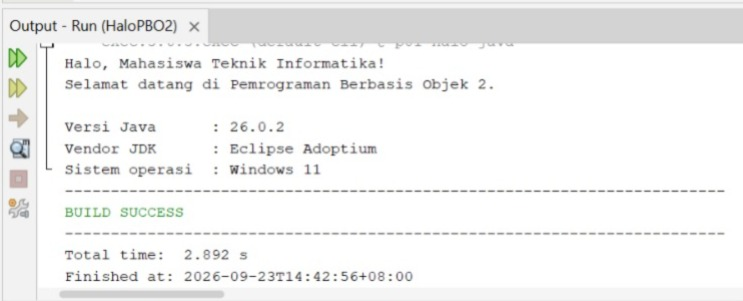

### 2. Program KartuMahasiswa
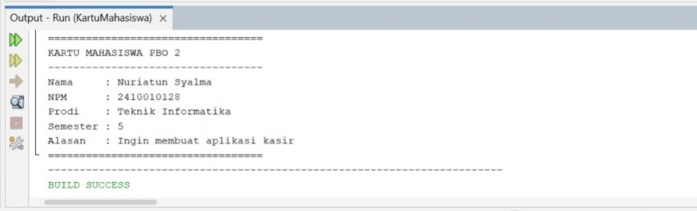

## Riwayat Commit Git

# Praktikum 2 - PBO 2
### 1. Hasil Run Program Skripsi
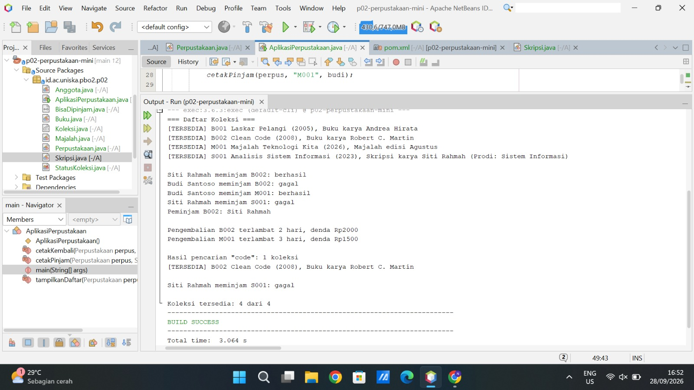

### 2. Jawaban Singkat Eksperimen
Eksperimen: lakukan satu per satu, amati hasilnya, lalu kembalikan kode seperti semula.

## 1.Tambahkan baris Koleksi x = new Koleksi("X01", "Uji", 2026); di method main. Apa pesan error dari kompiler dan mengapa?
(Terdapat juga peringatan/warning tambahan: Variable x is never read karena variabel x tersebut belum digunakan di mana pun). Kenapa itu bisa terjadi karena di baris kode 71, Anda mencoba membuat objek langsung dari kelas Koleksi menggunakan kata kunci new:

## 2.Pada kelas Buku, ubah nama method hitungDenda menjadi hitungdenda. Apa yang terjadi jika anotasi @Override ada, dan jika dihapus?
Jika ada @Override: Akan error. Java bingung karena di kelas induk namanya pakai 'D' besar (hitungDenda), jadi tidak ada method yang cocok untuk ditimpa.
Jika @Override dihapus: Tetap error. Kelas Buku itu wajib mewarisi dan membuat ulang method hitungDenda (D besar). Kalau pakai 'd' kecil, Java menganggap Anda membuat method baru dan mengabaikan tugas wajibnya.

## 3.Tambahkan new Buku("B009", "", 2020, "Anonim"). Apa yang terjadi saat program dijalankan?
Yang terjadi: Program kemungkinan besar akan error atau berhenti mendadak (crash) saat dijalankan.
Alasannya: Ada aturan di dalam kode yang melarang judul buku dikosongkan. Karena datanya tidak valid, program menolak membuat buku tersebut.

## 4.Ubah private StatusKoleksi status menjadi public, lalu ubah status B002 langsung dari main menjadi TERSEDIA saat masih dipinjam. Aturan apa yang dilanggar?
Aturan yang dilanggar: Enkapsulasi (aturan pelindungan data agar tidak bisa diubah sembarangan dari luar).
Alasannya: Bikin data kacau. Kalau diubah paksa, sistem akan mengira buku itu "Tersedia" dan bisa dipinjam orang lain lagi, padahal fisiknya masih dibawa oleh si peminjam pertama. Perubahan status harus lewat jalur resmi (method pinjam atau kembalikan).

# Praktikum 3 - PBO 2
### 1. Form Tiket Travel Tema Terang
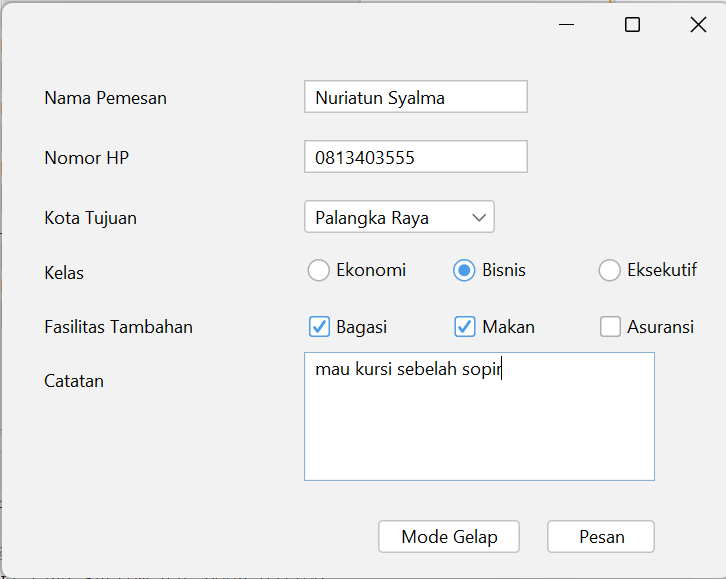

### 2. Form Tiket Travel Tema Gelap

### 3. Tab Design Tiket Travel
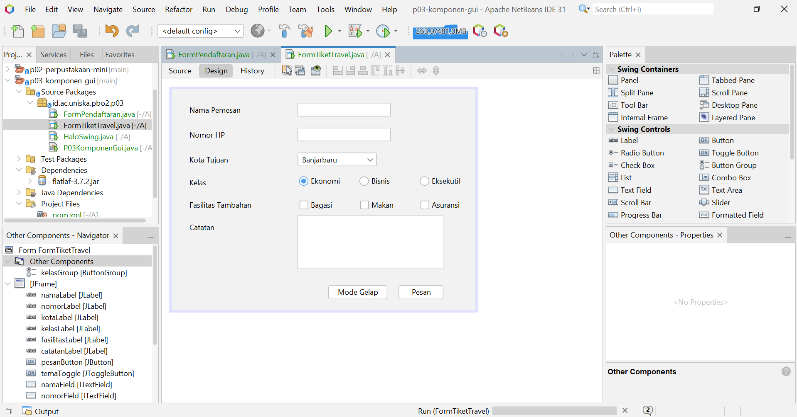

### 4. Jawaban Refleksi
## 1.Apa perbedaan top-level container, intermediate container, dan atomic component? Berikan masing-masing satu contoh.
Top-level container adalah jendela utama yang menjadi tempat menampilkan aplikasi. Contohnya JFrame.
Intermediate container adalah wadah yang digunakan untuk mengelompokkan komponen lain. Contohnya JPanel.
Atomic component adalah komponen yang langsung digunakan untuk berinteraksi dengan pengguna. Contohnya JButton.
## 2.Mengapa kedua JRadioButton perlu diberi properti buttonGroup yang sama?
Karena JRadioButton digunakan untuk memilih satu pilihan saja dari beberapa pilihan. Dengan memberikan buttonGroup yang sama, ketika satu pilihan dipilih, pilihan lainnya otomatis tidak terpilih. 
## 3.Kapan Anda memilih JComboBox dibandingkan JRadioButton?
Saya akan memilih JComboBox ketika pilihan yang tersedia cukup banyak, sehingga lebih menghemat tempat pada form. Sedangkan JRadioButton lebih cocok jika pilihannya sedikit dan ingin semua pilihan langsung terlihat.
## 4.Mengapa kode di dalam initComponents() tidak boleh diedit langsung, dan di mana kode tambahan seharusnya ditulis?
Karena initComponents() dibuat secara otomatis oleh NetBeans dari pengaturan pada tab Design. Kode tersebut dapat dibuat ulang atau berubah ketika form diedit, sehingga tidak boleh diubah langsung. Kode tambahan seharusnya ditulis di luar blok initComponents(), misalnya di konstruktor setelah initComponents(), pada event handler, atau pada method bantu.
## 5.Mengapa FlatLightLaf.setup() harus dipanggil sebelum form dibuat? 
Karena FlatLightLaf.setup() digunakan untuk mengaktifkan tema tampilan FlatLaf. Perintah ini dipanggil terlebih dahulu sebelum membuat form, agar form yang dibuat langsung menggunakan tampilan FlatLaf. 

# Praktikum 4 - PBO 2
### Jawaban pertanyaan refleksi pada bagian G
### 1. Mengapa Null Layout dan Absolute Layout sebaiknya dihindari?

Karena posisi komponen diatur secara manual, sehingga tampilan bisa berantakan ketika ukuran jendela berubah atau dibuka di layar yang berbeda. Lebih baik menggunakan layout manager agar komponen tersusun lebih rapi dan mudah menyesuaikan ukuran jendela.

### 2. Jelaskan perbedaan perilaku FlowLayout dan GridLayout saat jendela dilebarkan.

FlowLayout menyusun komponen secara berurutan dari kiri ke kanan. Kalau jendela diperkecil, komponen bisa pindah ke baris berikutnya. Sedangkan GridLayout membagi komponen ke dalam baris dan kolom dengan ukuran sel yang sama. Saat jendela dilebarkan, ukuran sel ikut menyesuaikan.

### 3. Apa fungsi Weight X dan Fill pada constraint GridBagLayout?

Weight X mengatur pembagian ruang tambahan secara horizontal untuk komponen. Kalau nilainya lebih besar, komponen mendapat bagian ruang yang lebih banyak. Fill mengatur apakah komponen akan memenuhi ruang yang tersedia. Contohnya, Fill Horizontal membuat komponen melebar mengikuti ruang yang ada.

### 4. Mengapa formPanel dibungkus isiPanel dan diletakkan di North?

Agar susunan form lebih teratur dan mudah diatur. Dengan isiPanel sebagai pembungkus, formPanel bisa ditempatkan di bagian atas menggunakan BorderLayout.NORTH, sehingga bagian form tidak memenuhi seluruh area dan masih ada ruang untuk bagian lain.

### 5. Sebutkan dua prinsip desain yang Anda terapkan pada Form Anggota Perpustakaan dan tunjukkan buktinya.

**a. Pengelompokan komponen**

Komponen yang berhubungan diletakkan berdekatan. Contohnya, NPM, nama lengkap, dan program studi dikelompokkan pada bagian Data Anggota, sedangkan email, nomor HP, dan alamat berada pada bagian Kontak.
# Bukti a

**b. Konsistensi dan kerapian**

Komponen disusun menggunakan layout manager agar lebih teratur. Contohnya, pilihan Mahasiswa, Dosen, dan Umum disusun berdekatan, sedangkan tombol Batal dan Daftar ditempatkan di bagian bawah sebelah kanan.
# Bukti b

# 1. Foto Sketsa
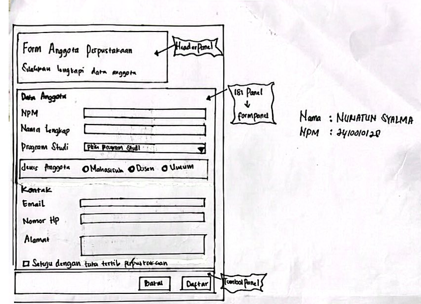

# 2. Tabel Rancangan
### Tahap 2: Tabel Rancangan

| Bagian | Panel | Layout |
|---|---|---|
| Jendela | JFrame | BorderLayout |
| Header | headerPanel | BoxLayout (Y_AXIS) |
| Isi form | isiPanel | BorderLayout |
| Data anggota | formPanel | GridBagLayout |
| Pilihan jenis anggota | jenisAnggotaPanel | FlowLayout (LEFT) |
| Tombol | tombolPanel | FlowLayout (RIGHT) |

# Hasil Form Anggota Perpustakaan
## 3. Form Ukuran Awal

## 4. Form Ukuran Lebar

## 5. Tab Design FormAnggotaPerpustakaan
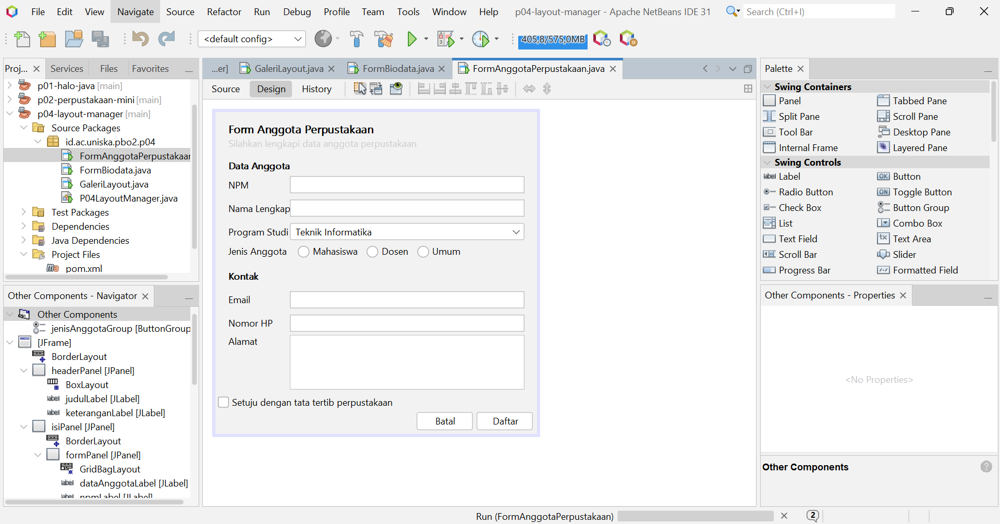

## Jawaban Eksperimen Praktikum 2
### Eksperimen:
### 1.Pada flowPanel, ubah Alignment layout menjadi Center, lalu kecilkan jendela. Apa yang berubah? 
(Ketika diubah tombol yang ada di dalam flowPanel jadi rata tengah dan ketika jendelanya diperkecil tombol yang tidak muat akan berpindah ke baris berikutnya tetapi tetap di posisi rata tengah.)
### Baris mana di initComponents() yang ikut berubah? 
(Yang berubah dalam initComponents() itu pengaturan alignment pada flowPanel yang awalnya FlowLayout.LEFT menjadi FlowLayout.CENTER)
### 2.Pada gridPanel, ubah Rows menjadi 0 dan Columns menjadi 2. Berapa baris yang terbentuk dan mengapa?
(Terbentuk jadi 5 baris dan 2 kolom, itu terjadi karena rows nya diganti menjadi 0 dan coloums nya jadi 2, sehingga barisnya otomatis berdasarkan komponen atau tombol yang ada, di dalam gridpanel ada 9 tombol, sehingga terbentuk lah 2 kolom dan 5 baris.)
### 3.Pada boxPanel, isi properti maximumSize keempat tombol dengan lebar 32767 dan tinggi sama dengan tinggi tombol. Bagaimana lebar tombol berubah? Tambahkan juga Vertical Strut dari kategori Swing Fillers di antara tombol.
(Setelah properti Maximum Size keempat tombol diatur dengan lebar 32767 dan tinggi sesuai tinggi tombol, lebar tombol dapat menyesuaikan ruang horizontal yang tersedia. Akibatnya, tombol terlihat lebih lebar dan memenuhi area panel. Penambahan Vertical Strut berfungsi memberikan jarak vertikal di antara tombol agar tampilannya lebih rapi dan tidak terlalu berdekatan.)

## Jawaban Eksperimen Praktikum 4
### Eksperimen:
### 1.Ubah Weight X pada namaField menjadi 0.0, lalu lebarkan jendela. Apa yang terjadi pada isian?
(Jika Weight X pada namaField diubah menjadi 0.0, lalu jendela dilebarkan, isian nama tidak ikut melebar untuk mengambil ruang tambahan. Lebar isian cenderung tetap, sedangkan ruang kosong di sebelahnya bertambah.)
### 2.Ubah Direction formPanel di dalam isiPanel dari North menjadi Center, lalu tinggikan jendela. Apa perbedaannya?
(Jika Direction formPanel di dalam isiPanel diubah dari North menjadi Center, form berpindah dari bagian atas ke bagian tengah secara vertikal. Saat jendela ditinggikan, form tetap berada di tengah, bukan menempel di atas.)
### 3.Hapus baris setMinimumSize(getSize()) di konstruktor, lalu kecilkan jendela sekecil mungkin. Bagian mana yang rusak lebih dulu?
(Jika baris setMinimumSize(getSize()) dihapus, jendela bisa diperkecil lebih jauh dari ukuran awal. Bagian yang kemungkinan rusak lebih dulu adalah susunan form: label dan kolom isian menjadi terlalu sempit, lalu komponen bisa saling berdekatan atau terpotong.)

## Jawaban Tahap 4 Saling Menilai
## Dinilai oleh Naura Aulia Jahirah

### CHECKLIST PEMERIKSAAN FORM ANGGOTA PERPUSTAKAAN

| No | Pemeriksaan | Ya atau Belum |
| :---: | :--- | :---: |
| 1 | Label singkat, jelas, dan sejajar | Ya |
| 2 | Isian dikelompokkan dengan judul bagian | Ya |
| 3 | Placeholder dipakai untuk isian yang punya format | Ya |
| 4 | Komponen sesuai jenis data | Ya |
| 5 | Tombol utama menonjol dan berada di kanan bawah | Ya |
| 6 | Jarak antar komponen konsisten | Ya |
| 7 | Form tetap rapi saat jendela dilebarkan dan ditinggikan | Ya |
| 8 | Menggunakan JFrame Form dan layout manager, bukan Null atau Absolute Layout | Ya |

### Deklarasi penggunaan AI:Saya menggunakan ChatGpt untuk membantu saya merapikan dan mengatur tampilan form, juga membantu commit ke github.

# Praktikum 5 - PBO 2
## 1. Tabel Pengamatan Praktikum 2
| No. | Tindakan | Event yang Tercatat |
|---|---|---|
| 1 | Arahkan kursor ke tombol, lalu jauhkan. | MouseEvent kursor masuk ke tombol, MouseEvent kursor keluar dari tombol. |
| 2 | Klik tombol "Klik saya". | ActionEvent tombol diklik. |
| 3 | Centang lalu hapus centang "Aktifkan fitur". | ItemEvent kotak dicentang, ItemEvent centang dihapus. |
| 4 | Ganti pilihan dari Pagi menjadi Malam. | ItemEvent memilih Malam. |
| 5 | Klik isian, lalu ketik kata "abc". | FocusEvent isian mendapat fokus, KeyEvent mengetik huruf a, KeyEvent mengetik huruf b, KeyEvent mengetik huruf c. |
| 6 | Klik tombol setelah mengetik di isian. | FocusEvent isian kehilangan fokus. |

## Jawaban Eksperimen Praktikum 3
### Eksperimen:
### 1. Hapus pemeriksaan if (evt.getStateChange() == ItemEvent.SELECTED) dan tambahkan System.out.println("item berubah"); di dalam event handler. Berapa kali pesan tercetak setiap pilihan diganti?
(Pesan tercetak 2 kali setiap pilihan di combo box diganti. Ini karena itemStateChanged dipanggil dua kali: sekali untuk pilihan lama yang berubah jadi DESELECTED, dan sekali lagi untuk pilihan baru yang jadi SELECTED. Makanya di kode asli ada if (evt.getStateChange() == ItemEvent.SELECTED) supaya aksinya cuma jalan sekali.)

### 2. Di jendela Properties bagian Events, kosongkan event keyReleased pada celsiusField, lalu buat event keyPressed yang memanggil konversi(). Mengapa hasil yang tampil terlambat satu karakter?
(Hasilnya terlambat satu karakter karena keyPressed dipicu saat tombol baru ditekan, padahal saat itu karakternya belum masuk ke isian. Jadi getText() di konversi() masih membaca isi yang lama.)

### 3. Hapus blok try dan catch di method konversi, lalu ketik huruf pada isian. Apa yang muncul di jendela Output?
(Karena Double.parseDouble("abc") gagal, program melempar NumberFormatException dan pesan error (stack trace) muncul di jendela Output, misalnya: Exception in thread "AWT-EventQueue-0" java.lang.NumberFormatException: For input string: "abc"
Selain itu, label hasil nggak diperbarui dan nggak ada pesan “Masukkan angka yang valid” untuk pengguna. Aplikasinya biasanya tetap jalan, tapi tampilannya jadi nggak informatif. Ini menunjukkan fungsi try-catch buat validasi input dan memberi umpan balik yang jelas ke pengguna.)

## Jawaban Eksperimen Praktikum 4
### Eksperimen:
### 1. Buat event actionPerformed untuk kaliButton melalui Events tanpa menghapus lambda di konstruktor, lalu tambahkan System.out.println("kali"); di kedua tempat. Berapa kali pesan tercetak? Mengapa satu tombol sebaiknya hanya memakai satu cara?
(Pesan tercetak 2 kali setiap tombol diklik, karena ada dua listener yang terdaftar di tombol yang sama: satu dari initComponents() (hasil GUI Builder) dan satu dari lambda di konstruktor. Keduanya sama-sama dipanggil. Kalau nggak cuma println, perhitungannya juga ikut jalan dua kali. Itu sebabnya satu tombol sebaiknya cuma pakai satu cara: biar aksinya nggak dobel, kodenya nggak membingungkan, dan gampang dicari kalau ada bug.)

### 2. Tambahkan tombol % untuk sisa bagi (modulus). Apa saja yang diubah di tab Design dan di tab Source?
(Yang diubah di tab Design:
a. Ubah operatorPanel dari Grid 1 baris 4 kolom menjadi 5 kolom.
b. Tambah Button baru di operatorPanel (misalnya modButton) dengan teks %.
c. Buat event actionPerformed untuk tombol itu lewat Events.
Yang diubah di tab Source:
a. Di event handler modButtonActionPerformed, isi dengan hitung('%');.
b. Di method hitung, tambahkan case '%' -> a % b; di dalam switch.
c. Sebaiknya perluas pemeriksaan pembagian nol, jadi if ((operator == '/' || operator == '%') && b == 0), karena modulus dengan nol juga bermasalah.)

### 3. Tekan tombol Hapus. Mengapa kursor langsung berada di isian pertama?
(Karena di akhir method hapus ada baris angka1Field.requestFocusInWindow();. Baris ini meminta fokus keyboard dipindahkan ke angka1Field, jadi pengguna bisa langsung ngetik angka baru tanpa klik isian dulu. Tanpa baris itu, fokus tetap ada di tombol Hapus.)

## 2. Peta Event pada FormAnggotaPerpustakaan

| No. | Komponen | Menu Events | Aksi |
|---|---|---|---|
| 1 | Kotak centang setuju | Item: `itemStateChanged` | Tombol Daftar hanya aktif jika kotak centang dicentang. |
| 2 | Tombol Batal | Action: `actionPerformed` | Mengosongkan semua isian dan mengembalikan fokus ke NPM. |
| 3 | Tombol Daftar | Action: `actionPerformed` | Menampilkan ringkasan data menggunakan `JOptionPane`. |
| 4 | Isian NPM | Key: `keyReleased` | Label kecil menampilkan jumlah digit, misalnya "8 dari 10 digit". |
| 5 | Form (JFrame di Navigator) | Window: `windowClosing` | Meminta konfirmasi sebelum aplikasi ditutup. |

## 3. Event untuk tombol daftar
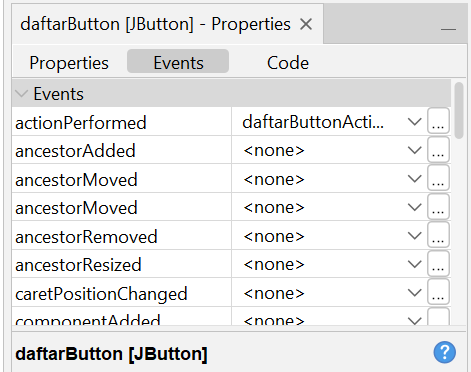

## 4. Layar Dialog Ringkasan
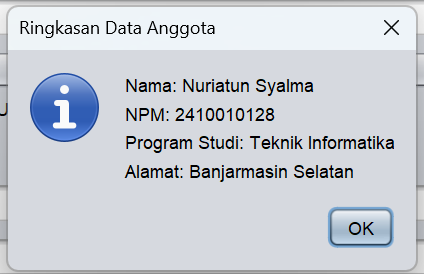

## 5. Layar Dialog Konfirmasi Keluar
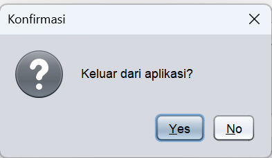

# Praktikum 6 - PBO 2
## 1. Lembar Peer Review
## Lembar Evaluasi Heuristik Form Anggota Perpustakaan

| No. | Heuristik | Temuan | Skor 0-4 | Saran |
|---|---|---|---|---|
| 1 | Visibilitas Status Sistem | Saat tombol "Daftar" diklik, muncul dialog "Pendaftaran berhasil" sehingga pengguna tahu data masuk. Namun, Email dan Nomor HP tidak tercetak di ringkasan data. | 1 | Tambahkan Email dan Nomor HP ke ringkasan sukses agar pengguna bisa mengecek ulang data. |
| 2 | Kesesuaian dengan Dunia Nyata | Judul di bagian atas jendela form masih kosong sehingga pengguna tidak langsung mengetahui aplikasi yang sedang dibuka. | 1 | Beri judul jendela yang jelas, misalnya "Pendaftaran Anggota Perpustakaan". |
| 3 | Kendali dan Kebebasan Pengguna | Setelah memilih "No" pada dialog konfirmasi Batal, fokus kursor tidak otomatis kembali ke kolom isian. | 2 | Kembalikan fokus kursor ke kolom terakhir menggunakan `requestFocusInWindow()`. |
| 4 | Konsistensi dan Standar | Ikon pada dialog konfirmasi berbeda meskipun judulnya sama. Penulisan label "Program Studi" juga berbeda antara form dan ringkasan sukses. | 1 | Samakan ikon dialog sejenis dan konsistenkan penulisan label. |
| 5 | Pencegahan Kesalahan | Terdapat pilihan kosong pada ComboBox Program Studi, tetapi form tetap bisa diproses meskipun program studi belum diisi. | 3 | Hapus pilihan kosong dan tambahkan validasi agar data tidak bisa diproses jika program studi belum dipilih. |
| 6 | Mengenali, Bukan Mengingat | Petunjuk format seperti "NPM harus berisi 10 digit angka" baru muncul setelah pengguna melakukan kesalahan. | 1 | Tambahkan petunjuk format sejak awal melalui placeholder atau teks di bawah kolom. |
| 7 | Fleksibilitas dan Efisiensi Penggunaan | Navigasi menggunakan Tab dan tombol Enter untuk mengirim data sudah berfungsi dengan baik. | 0 | Pertahankan fungsi navigasi keyboard yang sudah nyaman digunakan. |
| 8 | Desain Estetis dan Minimalis | Tampilan form sudah bersih, tetapi jarak label "Nama Lengkap" terlalu dekat dengan kotak input, teks subjudul terlalu pucat, dan terdapat sisa tanda petik di pojok kiri bawah. | 2 | Perbaiki jarak antarkomponen, gelapkan warna subjudul, dan hapus karakter yang tidak diperlukan. |
| 9 | Membantu Memperbaiki Kesalahan | Label penampung pesan error di pojok kiri bawah masih menampilkan tanda petik ganda sehingga terlihat seperti karakter sisa. | 1 | Kosongkan teks pada label tersebut atau hapus karakter yang tidak diperlukan. |
| 10 | Bantuan dan Dokumentasi | Form menyediakan checkbox "Setuju dengan tata tertib perpustakaan" sebagai panduan bagi pengguna sebelum mendaftar. | 0 | Pertahankan checkbox ketentuan tata tertib yang sudah berfungsi dengan baik. |

**Kesimpulan:** Beberapa aspek form sudah berjalan dengan baik, tetapi masih ada kekurangan yang perlu diperbaiki. Prioritas utama adalah pencegahan kesalahan dengan skor 3.

**Nama peninjau:** Novia Fitri

**Nama pemilik form:** Nuriatun Syalma

### Hasil Peer Review dan Perbaikan

| No. | Temuan | Perbaikan | Commit |
|---|---|---|---|
| 1 | Email dan nomor HP belum muncul pada ringkasan pendaftaran. | Menambahkan email dan nomor HP ke ringkasan pendaftaran. | Menyelesaikan P06-Validasi Input |
| 2 | Judul form belum ditampilkan. | Mengatur judul menjadi “Pendaftaran Anggota Perpustakaan”. | Menyelesaikan P06-Validasi Input |
| 3 | Fokus tidak kembali ke kolom sebelumnya ketika pembatalan tidak jadi. | Mengembalikan fokus ke kolom terakhir yang aktif. | Menyelesaikan P06-Validasi Input |
| 4 | Ikon dialog dan penulisan Program Studi belum konsisten. | Menyamakan tampilan dialog dan penulisan Program Studi. | Menyelesaikan P06-Validasi Input |
| 5 | Terdapat pilihan Program Studi kosong. | Menghapus pilihan kosong dan mempertahankan validasi. | Menyelesaikan P06-Validasi Input |
| 6 | Format NPM belum dijelaskan sejak awal. | Menambahkan petunjuk bahwa NPM terdiri dari 10 digit. | Menyelesaikan P06-Validasi Input |
| 7 | Navigasi menggunakan Tab dan Enter sudah berjalan dengan baik. | Mempertahankan fungsi navigasi yang sudah berjalan. | Menyelesaikan P06-Validasi Input |
| 8 | Jarak label, warna subtitle, dan karakter tambahan perlu diperbaiki. | Merapikan jarak komponen, memperjelas subtitle, dan menghapus karakter tambahan. | Menyelesaikan P06-Validasi Input |
| 9 | Label pesan kesalahan menampilkan karakter yang tidak diperlukan. | Menghapus teks awal yang tidak diperlukan pada label pesan kesalahan. | Menyelesaikan P06-Validasi Input|
| 10 | Checkbox aturan sudah berfungsi dengan baik. | Mempertahankan fungsi checkbox. | Menyelesaikan P06-Validasi Input |

### Kesimpulan

Berdasarkan hasil peer review, beberapa bagian form perlu diperbaiki agar tampilan lebih rapi, informasi lebih lengkap, dan penggunaan form lebih mudah. Fitur yang sudah berjalan dengan baik tetap dipertahankan.

## 2. Tampilan Layar dengan Pesan Kesalahan
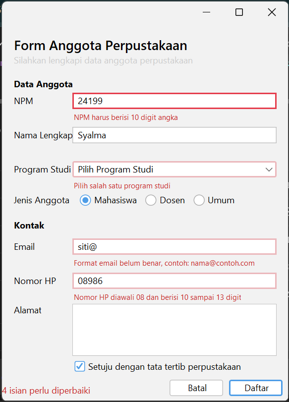

## 3. Tampilan Jendela Navigator
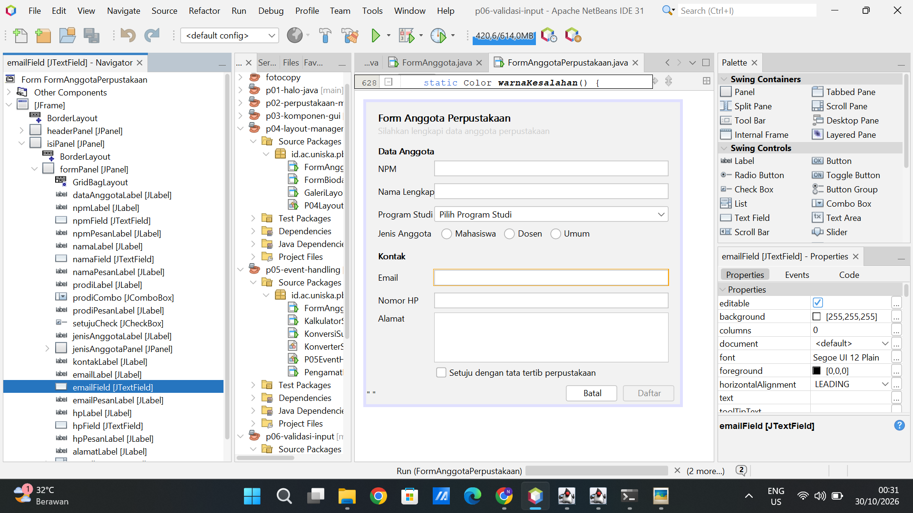

### Eksperimen: 
### 1. Ketik huruf pada isian NPM. Apa yang terjadi dan baris mana di npmFieldKeyTyped yang menyebabkannya?
(Saat mengetik huruf pada isian NPM, huruf tidak muncul dan isian tetap kosong. Penyebabnya adalah baris if (!Character.isDigit(evt.getKeyChar()) || penuh) { evt.consume(); } pada npmFieldKeyTyped. Huruf bukan digit, sehingga kondisinya benar dan evt.consume() membatalkan karakter sebelum masuk ke isian. Ini penerapan heuristik pencegahan kesalahan.)
### 2. Isi email dengan siti@, lalu tekan Tab. Kapan pesan kesalahan muncul? 
(Pesan kesalahan muncul saat tombol Tab ditekan, yaitu ketika fokus meninggalkan isian email, bukan saat mengetik. Hal ini karena pemeriksaan dilakukan oleh event emailFieldFocusLost yang memanggil periksaEmail(). Isian diberi garis merah dan muncul pesan “Format email belum benar, contoh: nama@contoh.com” di bawahnya.)
### 3. Klik isian Nama tanpa mengetik, lalu tekan Tab. Mengapa tidak ada pesan kesalahan?
(Tidak ada pesan kesalahan karena namaFieldFocusLost hanya memanggil periksaNama() jika isian tidak kosong (!namaField.getText().isBlank()). Isian yang hanya dilewati tidak langsung dianggap salah agar pengguna tidak merasa ditegur sebelum sempat mengisi. Isian kosong baru diperiksa saat tombol Daftar diklik.)
### 4. Centang persetujuan, lalu klik Daftar dengan form kosong. Isian mana yang mendapat fokus?
(Fokus pindah ke isian NPM. Method daftar() memeriksa semua isian sekaligus dan menyimpan yang salah ke daftar salah berurutan (NPM, Nama, Program studi, Email, Nomor HP). Baris salah.get(0).requestFocusInWindow() memindahkan fokus ke kesalahan pertama, yaitu NPM. Semua isian bertanda merah dan muncul ringkasan “5 isian perlu diperbaiki” di bagian bawah form.)
### 5. Tekan tombol Alt bersama huruf N. Isian mana yang mendapat fokus, dan properti apa yang mengaturnya?
(Fokus pindah ke isian Nama lengkap (namaField). Yang mengaturnya adalah properti displayedMnemonic bernilai N pada namaLabel (menentukan huruf pintasan yang bergaris bawah) dan properti labelFor yang menunjuk ke namaField (menentukan komponen yang menerima fokus).)
### 6. Isi beberapa isian, lalu klik Batal dan pilih No. Apakah data tetap ada?
(Data tetap ada. Method batal() menampilkan dialog konfirmasi “Data yang sudah diisi akan dihapus. Lanjutkan?” karena adaIsian() bernilai benar. Saat memilih No, jawab bukan YES_OPTION sehingga method berhenti lewat return dan kosongkan() tidak dijalankan. Ini penerapan heuristik kendali dan kebebasan pengguna.)

### Deklarasi penggunaan AI:Saya menggunakan Claude AI untuk membantu mengerjakan langkah praktikum yang kurang saya pahami,dan juga ChtGpt membantu saya menjelaskan jawaban ekperimen dan perbaikan dari hasil temuan teman saya terhadap proyek yang saya buat.

